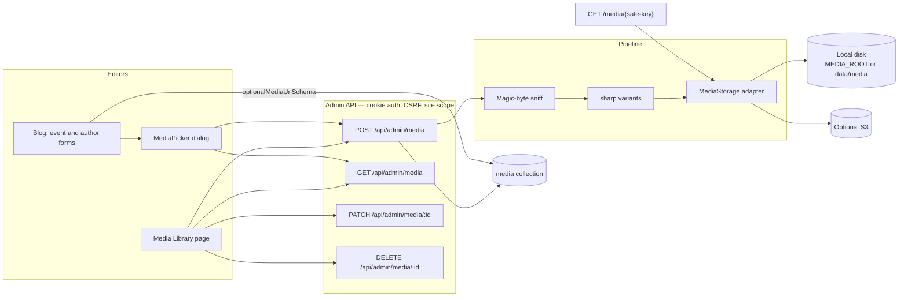
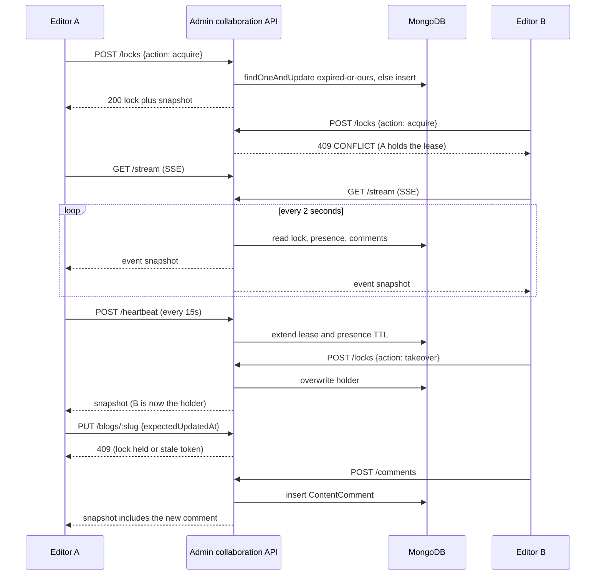

# CogCMS

A self-hostable, multi-site headless CMS built with Next.js 16, React 19, MongoDB/Mongoose, TypeScript and Vitest. Manage blogs, authors, FAQs, whitepapers and release notes in one editorial workspace, and deliver published content to your websites through a versioned API or restricted MongoDB views.

The CMS includes site-scoped users and API keys, editorial previews, stored blog rendering, signed publishing notifications, newsletter and FAQ intake, and optional S3 media uploads. Websites own their presentation. Start with the local demo below or [set up your own installation](docs/DEPLOYMENT.md).

## Assignment

This public repository, [Ranbir5ingh/CogCMS](https://github.com/Ranbir5ingh/CogCMS), extends CogCMS with two complete, site-scoped features for a take-home assignment:

- **Media Library** — validated image uploads, generated size variants, alt text, a library UI, and a reusable picker in the blog, event and author editors.
- **Live Collaboration** — SSE presence, lease-based edit locks with heartbeat and takeover, a stale-save guard, and document comments with live updates.

Both features are described in full below (overview, architecture, design decisions, technology choices, setup, and limitations). The original CogCMS product documentation is preserved in this file and in `docs/`. The optional in-repo [ASSIGNMENT.md](ASSIGNMENT.md) is a different, pre-existing pagination exercise and is not the scope of this work.

## Local setup

Use Node 22 (`.nvmrc`), npm and your own **MongoDB 8.2.5 replica set**; the project does not supply a database. A standalone `mongod` starts the app, but the transactional `/api/v1` intake rate limiter then fails with `Transaction numbers are only allowed on a replica set member`. Media upload is optional and disabled when the three `S3_*` values are unset.

Get the source and enter the project directory:

```sh
git clone https://github.com/Ranbir5ingh/CogCMS.git
cd CogCMS
```

Then complete these steps from that directory:

1. Start a local single-node replica set with one of these options. Do not point these commands at a shared database.
   - **Installed MongoDB and `mongosh`:** create an empty local data directory and start MongoDB with `mongod --replSet rs0 --bind_ip 127.0.0.1 --port 27017 --dbpath <empty-local-directory>`. In a second terminal, connect with `mongosh mongodb://localhost:27017` and run `rs.initiate({_id: 'rs0', members: [{_id: 0, host: 'localhost:27017'}]})` once.
   - **Docker:** run `docker run -d --name cogcms-mongo -p 127.0.0.1:27017:27017 mongo:8.2.5 --replSet rs0 --bind_ip_all`, then once `docker exec cogcms-mongo mongosh --quiet --eval "rs.initiate({_id: 'rs0', members: [{_id: 0, host: 'localhost:27017'}]})"`.
   - **No Docker or system MongoDB:** run `npm run dev:mongo`. This starts a single-node replica set with `mongodb-memory-server` (the same binary the test suite uses), prints a `MONGODB_URI`, and stays running until you press Ctrl+C. Put that URI in `.env` (and keep `MONGODB_DB_NAME=cms_public_demo`) before the seed commands. Data is stored under `.next/dev-mongo/`.
2. Run `npm ci`, copy `.env.example` to `.env`, and set a new local `CMS_JWT_SECRET` (at least 32 characters) and local `CMS_SEED_ADMIN_PASSWORD` (at least 12 characters). Only the "Required for local development" section matters for this demo. The example email is fictional. Keep `MONGODB_DB_NAME=cms_public_demo` and set `MONGODB_URI` to `mongodb://localhost:27017/?replicaSet=rs0` (installed MongoDB or Docker) or to the URI printed by `npm run dev:mongo`.
3. Run `npm run seed:admin`, `npm run ensure:indexes`, then `npm run seed:demo`. The demo seed refuses remote MongoDB targets, any database name other than `cms_public_demo`, and an existing site or blog. It creates two fictional sites and 48 blogs; it never overwrites existing records.
4. Run `npm run dev` and open `http://localhost:3003/admin/login`. Sign in with the local admin, then choose **Northstar Studio** or **Harbor Notes** from the site selector. Explore the editors or create a site of your own. The demo has no public website, so its public View links are illustrative.

To reset, stop the app and verify that the target is your disposable local `cms_public_demo` database before dropping it with `mongosh`; then repeat the seed commands. No reset command is bundled so a copied command cannot silently erase another database. With the Docker option, `docker rm -f -v cogcms-mongo` discards that container and its data.

A hosted replica set such as a MongoDB Atlas cluster also runs the app, but `seed:demo` accepts only a local target, so you start there without demo content.

## Checks

Run `npm run typecheck`, `npm test`, and `npm run build` sequentially. Unit and integration tests use a separate temporary MongoDB replica set. If its binary is not cached, `mongodb-memory-server` may download one. Report any setup or baseline failure separately from your changes.

## Media Library

### Feature overview

Each site has a private image library. Editors upload a JPEG, PNG, WebP, GIF or AVIF file (up to 10 MiB). The server sniffs magic bytes, rejects a MIME mismatch or a dangerous type (for example SVG or PDF), and stores:

- the original file, unchanged;
- WebP derivatives capped at 320, 768 and 1280 pixels on the long edge, never upscaled.

A 400-pixel-wide image therefore keeps its original, a 320 WebP thumbnail, a 400 WebP medium, and a large size that aliases the medium file rather than writing a duplicate. Animated sources use the first frame. Alt text is encouraged on upload (assets with an empty alt show a "Missing alt" badge and an accessibility hint) and is required before the picker inserts an image into a document. Editors can search and paginate the library, edit alt text, and delete an unused asset. A delete that would break a blog, event, whitepaper, author avatar or site logo is rejected with a 409 and a list of references; the UI does not offer a force-delete.

The reusable `MediaPicker` is wired into the blog cover and inline-image flows, the event cover, and the author avatar, wherever those forms previously asked for a raw image URL. Pasting an external `https` URL still works. Uploaded files are served from `/media/{key}` with `nosniff`, an immutable cache header, and a strict key allow-list that rejects path traversal and the staging prefix used by the older S3 direct-upload path.

### Architecture



Request flow for an upload: `requireUser` then a multipart same-origin CSRF check, Zod-adjacent validation of the file and alt, magic-byte sniff, `validateImage`, `storeVariants`, `Media.create`. If the document write fails, stored files are cleaned up. Listing is a case-insensitive literal `$regex` on the original name and alt (the search string is escaped, never treated as a regex the client sends). The public file route is unauthenticated on purpose: URLs are unguessable keys, not a capability granted by a session, so published pages can render them.

### Design decisions and trade-offs

- **Adapter instead of talking to the filesystem from the route.** A `MediaStorage` interface (`put`, `get`, `delete`, `publicUrl`) has a local-disk default and an S3 implementation that reuses the existing AWS client. Alternative: only S3, which would force cloud credentials on a local demo; or only disk, which would not scale to a multi-instance host. The adapter keeps both. Local disk is the right default: `data/` is already gitignored, and no AWS account is required.
- **Magic bytes are authoritative.** Declared `Content-Type` must agree with the sniff, and SVG, HTML and PDF are rejected even if renamed. Alternative: trust the client MIME, which is trivial to spoof.
- **sharp, already a dependency**, for derivatives. Alternative: ImageMagick as a binary (worse to ship), or store only the original (heavier pages, no art-directed sizes in the picker). We never upscale, and we alias identical dimensions so a small source does not produce three identical files.
- **Alt text is encouraged, and required at insert time.** Alternative: hard-require alt on every upload, which blocks a "stash this file, write the caption later" workflow; or never require it, which fails accessibility. The library lets you upload with an empty alt and badges the asset; the picker will not insert until alt is present.
- **Usage-checked delete, no force in the UI.** The API accepts `?force=true` for an explicit break-glass, but the library only shows the references and refuses. Alternative: silent cascading clears of `imageUrl`, which is surprising in a CMS.
- **First-party `/media/…` URLs are allowed in editorial image fields**, through a narrow `optionalMediaUrlSchema`. The global `isPublicHttpUrl` helper is unchanged and still rejects localhost, so we do not weaken URL checks elsewhere. Alternative: loosening `isPublicHttpUrl` itself, which would have accepted `http://localhost/…` in any field.
- **Do not change `/api/v1`.** Published consumers keep receiving an `imageUrl` string. Alternative: a new public media resource, which would be a contract change out of scope.
- **Site isolation is a `siteId` on every document and query**, plus the existing `x-cms-site` / `cms_site` resolution. There is no shared global library.

### Technology choices

| Choice                                            | Why                                                                                                  |
| ------------------------------------------------- | ---------------------------------------------------------------------------------------------------- |
| **sharp**                                         | Already used for `validateImage`; fast, first-frame WebP; no new dependency.                         |
| **Magic-byte tables** (`lib/media/magic.ts`)      | Small, dependency-free, and explicit about the five accepted image types.                            |
| **Local disk via `MEDIA_ROOT`**                   | Zero-config for development and tests; temporary directories in the integration suite.               |
| **Optional `S3MediaStorage`**                     | Reuses the project's AWS client when `S3_REGION`, `S3_BUCKET_NAME` and `S3_PUBLIC_URL` are all set.  |
| **Mongoose `Media` model**                        | Matches every other collection: `siteId`, audit fields, `ensure-indexes` registration.               |
| **`optionalMediaUrlSchema`**                      | First-party `/media/{SAFE_MEDIA_KEY}` or a public `http(s)` URL, without relaxing global URL policy. |
| **Next.js App Router route `app/media/[...key]`** | Serves bytes with `nosniff` and an immutable cache; the key must match `SAFE_MEDIA_KEY`.             |

### Setup and usage

Follow [Local setup](#local-setup). No extra service is required for the library.

1. Sign in at `/admin/login`, select a site, and open **Media** in the sidebar (`/admin/dashboard/media`).
2. Drag a file onto the grid or use the upload button. Add alt text (recommended). The asset appears with thumbnail, dimensions and size.
3. Search by file name or alt, paginate, edit alt, or delete. A referenced asset explains where it is used.
4. In a blog, event or author form, choose **Choose from library**. Search or upload, set alt if it is missing, pick a size (thumbnail, medium, large or original) and insert. The form stores the public `/media/…` URL (or the S3 URL when that adapter is active).

To use S3 instead of disk, set the three `S3_*` variables. To relocate local files, set `MEDIA_ROOT`. Generated files under `data/media` are gitignored.

### Limitations and future work

- Local disk is per-instance; a multi-replica production host should use the S3 adapter (or a shared volume).
- Only the five raster image types above. No video, PDF or SVG (SVG is rejected deliberately because it can carry script).
- GIF and animated WebP are stored as an original plus a still first-frame derivative, not as animated output.
- There is no virus scanning, EXIF stripping beyond what sharp's re-encode does for derivatives, or automatic alt-text generation.
- The public `/api/v1` contract is unchanged: consumers still see a URL string, not a structured `sizes` object.
- Whitepaper documents have an `imageUrl` field but no cover-image UI yet, so the picker is not mounted there.
- Force-delete exists only on the API; an admin-only UI would need a stronger confirmation than a regular delete.

## Live Collaboration

### Feature overview

When two editors open the same existing blog, event or whitepaper, they can see who else is viewing or editing, they cannot silently overwrite each other, and they can leave comments that update live.

- **Presence** is a heartbeat: opening the document records you, and a 30-second TTL drops you after you leave.
- **Edit locks** are a 45-second lease renewed every 15 seconds while the holder's tab is open. Acquire is atomic. A second editor is told who holds the lock and can **take over** after a confirmation dialog. The form is read-only until they hold the lock. Releasing happens on leave (`keepalive` on unmount) or when the lease expires.
- **Stale-save guard:** existing-document PUTs accept an optional `expectedUpdatedAt`. If it does not match the document, the write returns 409. A write is also rejected if someone else holds a live lock. Older clients that omit the token still save when no foreign lock is held, so existing tests and tools keep working.
- **Comments** are plain text (1–2000 characters) with an optional field anchor (`title`, `excerpt`, `content`, `image`, `meta`). Any authorised editor on the site can resolve or reopen; only the author or an admin can delete. Empty bodies are rejected.
- **Transport:** the browser opens an EventSource to `/api/admin/collaboration/stream`. The server polls Mongo every two seconds and pushes a snapshot when it changes. If SSE fails, the hook falls back to the same snapshot over HTTP polling, and the chrome shows a "Polling" hint. There is no paid realtime service and no Mongo change stream.

New, unsaved drafts have no `resourceId` yet, so they stay unlocked until the document exists.

### Architecture



All routes sit under `/api/admin/collaboration/*`, are cookie-authenticated, site-scoped, and CSRF-protected on mutations. The SSE route authenticates first and leaves presence on abort. Snapshots never include `siteId`. Collections: `content_locks` (unique on site plus resource), `content_presences` (unique on site, resource and user), `content_comments`. TTL indexes on `expiresAt` are a backstop; queries also filter `expiresAt > now` because Mongo's TTL monitor can lag by up to a minute.

### Design decisions and trade-offs

- **SSE plus HTTP POST, polling Mongo, not change streams.** The repo's DocumentDB guard forbids `.watch(`, `$text`, `$where`, `.collation(` and `partialFilterExpression`. Alternative: Socket.IO or a paid service (Pusher, Ably), which adds infrastructure and a new auth story; or Mongo change streams, which fail on DocumentDB and need a resumable cursor. Two-second polling is a few milliseconds of query load and is easy to reason about. Latency is the trade-off, and is acceptable for presence and comments.
- **Lease lock, not a hard mutex and not OT/CRDT.** This is an editorial CMS, not a Google-Docs canvas. Alternative: full operational-transform collaborative editing (large, out of scope) or "last write wins" (the bug the assignment wants to close). A 45-second lease with a 15-second heartbeat survives a brief blip and frees the document if a laptop lid closes. Takeover is explicit, never silent.
- **Optimistic `expectedUpdatedAt` on the server**, even when the UI is read-only. The lock is the social layer; the token is the safety net if a lease expired mid-edit or two tabs raced. Alternative: only ETags, or only the lock — either alone can miss a case.
- **Comments in their own collection**, not embedded on the blog, event or whitepaper document. Alternative: embedding, which would contend with content PUTs and bloat those documents. Separate documents keep comment writes off the content lock (you can comment while someone else edits).
- **Plain text, optional field anchor, no threads.** Alternative: rich text or a full review system with @mentions and reply trees — useful later, but a lot of sanitisation and UI for a first version. Resolve and delete cover the editorial loop.
- **Polling fallback in the client.** EventSource is widely supported but can fail behind some proxies. Alternative: polling only, which is simpler but chattier; we prefer SSE and degrade quietly.
- **Do not auto-release the lock on SSE abort.** A refresh would otherwise drop the lease. The client releases on unmount; expiry is the safety net.

### Technology choices

| Choice                                           | Why                                                                                                          |
| ------------------------------------------------ | ------------------------------------------------------------------------------------------------------------ |
| **`EventSource` (SSE)**                          | Cookie-authenticated GET, automatic reconnect, no new library, works with the existing Next.js Node runtime. |
| **Mongo polling every 2s**                       | DocumentDB-safe; snapshot comparison avoids noisy identical frames (keep-alive comments still flow).         |
| **`findOneAndUpdate` plus a unique index**       | Atomic acquire. A raced insert surfaces as `11000` and becomes a 409 for the loser.                          |
| **TTL indexes (`expireAfterSeconds: 0`)**        | Same pattern as `LoginAttempt`; queries still filter on `expiresAt`.                                         |
| **`expectedUpdatedAt` as an optional ISO field** | Stripped from Zod content schemas; compared with `Date#getTime` against `updatedAt`.                         |
| **`ConfirmDialog`**                              | Existing Radix alert dialog for takeover, so the wording is the only new decision.                           |
| **`keepalive` fetch on unmount**                 | Releases the lease when the tab closes, without a new protocol.                                              |

### Setup and usage

No extra process beyond the [local replica set](#local-setup) (including `npm run dev:mongo`) and `npm run dev`.

1. Create and save a blog, event or whitepaper (collaboration starts only once the document has an id).
2. Open the same URL as a second user (or a second browser profile) on the same site.
3. Avatars in the editor header show who is viewing (green) or holding the lock (orange). The holder sees a green "You are editing" bar; everyone else sees an amber bar with **Take over editing**.
4. While you do not hold the lock, the form is inert, save is disabled, and a save that slipped through would 409.
5. Open **Comments** to leave a note, optionally attach it to a field, resolve or delete. New comments appear for other open editors within about two seconds (or on the next poll).
6. Heartbeat is automatic. Close the tab and the lease expires within 45 seconds if the release request did not already run.

To exercise two users locally: `npm run seed:admin`, create a second user under **Users**, and sign in from a private window.

### Limitations and future work

- This is a presence and lock layer, not concurrent rich-text editing. Two holders still cannot type in the same Quill document at once.
- SSE snapshots are at most two seconds behind; a busy comments thread is not instantaneous.
- Presence and locks are per-document, not per-field. Two people cannot lock the title and the body independently.
- Comments are flat and plain-text; no @mentions, attachments, or email notifications.
- New unsaved drafts are intentionally unlocked. After the first save the editor currently redirects to the list, so collaboration on a just-created document starts the next time it is opened.
- Takeover does not force the previous holder's tab to discard its buffer; it makes their next save 409 (stale or lock). That is safer than wiping their work, but they need to copy unsaved text out themselves.
- The polling fallback is slightly more chatty. A future WebSocket path could land behind the same snapshot schema without changing the UI hook.

## Boundaries

- Admin routes use a login session and active-site selection. `/api/v1` uses site-scoped keys and exposes published content only.
- Website rendering stays in the consumer; this repository owns editorial UI, content models and publication contracts. See [architecture](docs/ARCHITECTURE.md).
- Local editorial use needs no cloud account or paid service. Optional media and hosted installations use your own resources. See [deployment notes](docs/DEPLOYMENT.md).
- Keep credentials out of the repository. `.env.example` contains placeholders only.

Read [CONTRIBUTING.md](CONTRIBUTING.md) to contribute. The optional [assignment](ASSIGNMENT.md) provides a bounded example contribution; it does not define the scope of the product.

## Community and maintenance

- [Support](SUPPORT.md): questions, bug reports and feature requests.
- [Code of Conduct](CODE_OF_CONDUCT.md): participation and reporting concerns.
- [Security policy](SECURITY.md): private vulnerability reporting and maintenance scope.
- [Changelog](CHANGELOG.md): release status and notable changes.

This is the initial public-source preparation. There are no published stability or long-term support guarantees; review the deployment guide before running an installation with real data.

Licensed under the [MIT License](LICENSE), copyright 2026 Aman Mundra. See [source provenance](PROVENANCE.md) for the project's origins. This source distribution includes no private installation history or customer dataset.
